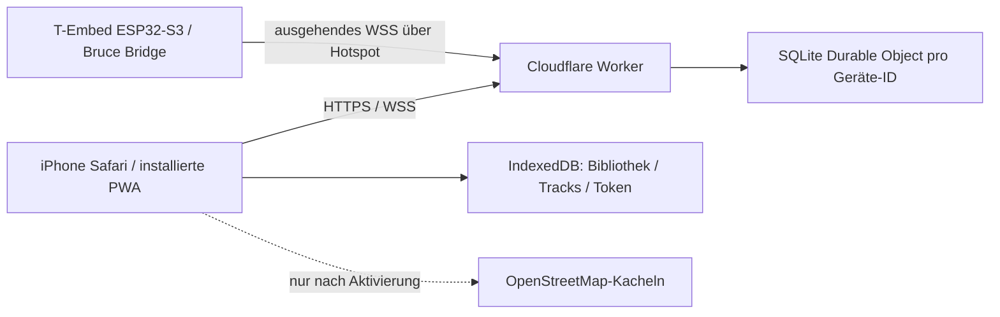

# Architektur

GitHub Pages liefert nur statische Dateien. Weder lokale Geräte-IP noch eingehende Ports am iPhone sind für den Hauptpfad erforderlich. Der persönliche Hotspot muss vom Benutzer aktiviert werden. Keine Cloud-Tunnel-App und kein BLE im Safari erforderlich.

## Pakete

- `apps/web`: React 19, TypeScript, Vite 6, Tailwind 4, Lucide, Leaflet 1.9, idb, PapaParse. Geolocation nur nach Benutzeraktion. Echte Gerätefähigkeiten steuern Befehlsfreigabe.
- `apps/relay`: Workers-ES-Modul, exportierte Room-Klasse, SQLite-Durable-Object, WebSocket Hibernation mit Auto-Response `ping`/`pong`, aufbewahrte Attachments. RPC für HTTP-Operationen, fetch für den WebSocket-Upgrade (ein Upgrade-Response lässt sich nicht als regulärer RPC-Response übertragen).
- `packages/protocol`: versionierte Schemas und Beschränkungen. JSON-Control, binäre Bildschirmframes, dateiseitige Blöcke mit maximal 3072 Nutzbytes (Base64 im JSON). **Generische binäre Dateiübertragung ist noch nicht implementiert.**
- `firmware`: gepinnter Upstream, deterministisches Overlay, WebSockets 2.7.2, unveränderte Boardpins und vorhandene CLI-/Displayhandler. Netzwerk in eigenem Task, Befehle in vorhandener CLI-Task, begrenzte FreeRTOS-Queues. Keine blockierenden TLS-Aufrufe auf dem Menü-Task.

## Protokoll v1

Gerät erzeugt ID/Token → HTTPS `POST /v1/devices/:id/enroll` → WSS `/ws` → erstes Frame `{v:1,type:"auth",role:"device",token}`. Browser gleicher Transport, `role:"browser"`. Server sendet `ready` mit zufälliger Sitzungsnonce und Gerätepräsenz.

Befehl: `{v:1,type:"command",id:UUID,nonce:UUID,seq:1,ts:UnixMillis,method:"device.info",params:{}}`.

Relay prüft Schema, Zeitfenster, Nonce, Sequenz, Deduplizierung und offene Aufträge; persistiert nur ID/Deadline, bestätigt mit `ack`, leitet weiter. Firmware prüft Alter und eigenes ID-Ledger, sendet `{v:1,type:"result",id,ok,data,error}`. `ack` bestätigt nur Weiterleitung. Der Browser wartet maximal 16 Sekunden; Relay markiert offene Aufträge nach 15 Sekunden abgelaufen. Bei Ungewissheit keine Wiederholung. Heartbeat alle 25 Sekunden, Abbruch nach 60 Sekunden ohne Pong im Browser / 70 Sekunden am Gerät.

### Pairing

1. Physisches Gerätemenü öffnet 120-Sekunden-Fenster und zeigt ID/8-stelligen Code.
2. `pair.open` speichert nur Codehash; Browser sendet Code über HTTPS `POST /pair`.
3. Relay liefert zufälliges Claim-Secret und zunächst inaktives Browser-Token, informiert Gerät über Claim.
4. Encoderbestätigung erzeugt `pair.approve`. Remote-Eingaben sind während des Gerätemenüs gesperrt.
5. Browser pollt `POST /claim`, speichert Token erst bei Freigabe in IndexedDB. Tokens erscheinen nie in URL oder Log.

### Speicher und Kosten

Ein Durable Object pro Gerät, keine zentrale global blockierende Session. Hibernation-Anhänge halten Rollen/Sequenzen, SQLite-KV hält Hashes und kurze Request-IDs. Alarme nur bei anstehenden Abläufen, keine dauerhaften 30-Sekunden-Timer. Bildschirmstream startet nur im Remote-Bereich auf Aktion, standardmäßig manuell. GPS-Übertragung nur eingeschaltet und bei gültiger Position. Benutzerbibliothek und GPS-Tracks werden nicht in Cloudflare persistiert.

Cloudflare-Konfiguration mit `cf` (`apps/relay/cloudflare.config.ts`), kein Wrangler-Migrationsmix. Deployment dieser Sitzung über den verbundenen Cloudflare-API-Zugang. Für eigene spätere Deployments: `npx cf auth login`, dann im Relay-Verzeichnis `npx cf deploy`. Kein kostenpflichtiger Plan wurde aktiviert.

## Fehler und Konkurrenz

Nur eine aktive Browser- und eine Geräteverbindung pro Raum; Reconnect ersetzt vorherige Verbindung. Pending-Aufträge werden bei Abbruch verworfen, keine Offline-Befehlswarteschlange. Eingaben sind Pulse mit begrenzter Dauer. Geräteoffline und Relayverbindung sind getrennte Zustände. Ungültige/fehlende Fähigkeiten sperren Bedienelemente. Datum/Uhrzeit muss auf ESP32 per NTP gültig sein, sonst wird TLS nicht aufgebaut.
